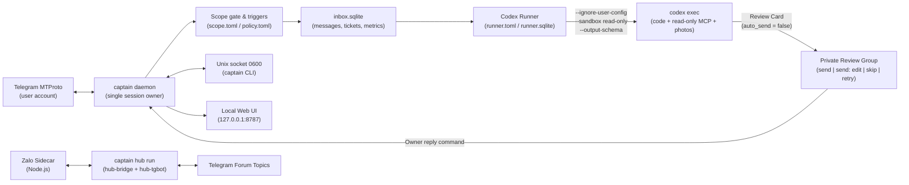

# comms-hub

[](https://github.com/nguyentantai21042004/comms-hub/actions/workflows/ci.yml)
-orange)


Personal communications daemon, isolated Codex triage runner, Zalo-to-Telegram bridge, and local analytics dashboard written in Rust.

One process (`captain daemon`) owns your Telegram user session over MTProto via [grammers](https://codeberg.org/Lonami/grammers), keeps credentials strictly inside the macOS Keychain, watches only chats allowlisted in `scope.toml`, and routes burst-coalesced tickets through a read-only Codex runner to a private Telegram review group.

## Architecture



## Capabilities

- **Single-session MTProto daemon**: maintains one authenticated user connection with reconnect backoff, peer caching, gap tracking, and a 30-day rolling SQLite store (`inbox.sqlite`).
- **Deterministic inbox pipeline**: default-deny scope gate (`scope.toml`), per-chat triggers (`dm_all`, `mention`, `reply_to_me`, `keyword`), burst coalescing (`policy.toml`), manual `cap:` forwards from Saved Messages, and phase-1 quality reports (`captain report --text`).
- **Isolated Codex triage runner**: runs `codex exec` with `--ignore-user-config`, `--sandbox read-only`, `--ephemeral`, `--output-schema`, optional read-only MCP endpoints, and up to 3 downloaded burst photos (`-i`). Stores run history separately in `runner.sqlite` so read-only dashboard attaches stay schema-compatible.
- **Private review-group workflow**: posts structured review cards (source link, incoming snippet, investigation summary, ready-to-send draft) to a private supergroup owned exclusively by you. Outbound messages require an explicit reply command unless `auto_send` and per-chat allowlists are turned on.
- **Non-notifying Telegram organization CLI**: batch contact renaming (`add_phone_privacy_exception: false`), local-only DM deletion (`revoke: false`), chat folder management/ordering, and private supergroup creation.
- **Zalo bridge and unified dashboard**: bridges Zalo conversations into Telegram forum topics (`captain hub`) and exposes a local token-gated web UI (`captain ui`) covering overview metrics, tickets, scope, and analytics.

## Workspace layout

| Crate | Layer | Responsibility |
|---|---|---|
| `captain-core` | core | Protocol-agnostic types (messages, entities, contacts, folders, Telegram limits). No I/O. |
| `captain-protocol` | protocol | MTProto adapter over `grammers`: login, Keychain session, media, contacts, folders, history cleanup. |
| `captain-format` | format | Authoring syntax to `FormattedText` (UTF-16 entities). No network I/O. |
| `captain-vault` | secrets | macOS Keychain secret wrapper (`<redacted>` Debug/Display) and `0600` atomic state files. |
| `captain-inbox` | domain | Pure inbox rules: scope matching, triggers, burst coalescing, triage, report math. |
| `captain-store` | storage | `inbox.sqlite`: scoped messages, tickets, ticket events, metric events, gate drops. |
| `captain-ipc` | transport | Owner-only Unix socket JSON-lines protocol between CLI clients and the running daemon. |
| `hub-core` | bridge core | Shared bridge event, adapter, outbound, and health traits. |
| `hub-store` | bridge store | Bridge topic maps, message maps, retries, and module health tables. |
| `hub-zalo` | adapter | Node sidecar supervisor and normalizer for Zalo. |
| `hub-tgbot` | adapter | Telegram Bot API client for forum topics, albums, reactions, and rate limits. |
| `hub-bridge` | orchestration | Bidirectional routing between external adapters and Telegram forum topics. |
| `hub-analytics` | analytics | Time-series, heatmap, funnel, and attention queries for the web UI. |
| `hub-web` | web | Axum read-only API routes and query/mask helpers for the dashboard. |
| `apps/captain-cli` | app | The `captain` binary: CLI, daemon, Codex runner (`runner.rs`, `runner_store.rs`), hub bridge, web UI. |

Architecture rules and crate dependency boundaries are documented in [docs/architecture.md](docs/architecture.md) and [docs/CONVENTIONS.md](docs/CONVENTIONS.md). Design documents live in [docs/design/](docs/design/).

## Quick start

### 1. Build and authenticate

You need a Telegram API ID and hash from <https://my.telegram.org/apps>.

```sh
make build
cp target/release/captain ~/.local/bin/captain

captain auth init      # stores API ID/hash in macOS Keychain
captain auth login     # interactive phone, login code, and 2FA password
captain auth status
```

### 2. Configure scope and policy

State files live in `~/Library/Application Support/telegram-captain/<profile>/`:

- `scope.toml`: allowlisted DMs, groups, and forums (see [docs/design/scope.md](docs/design/scope.md)).
- `policy.toml`: burst debounce windows, stale thresholds, and retention limits.

```sh
captain chats --limit 100
captain scope check
captain daemon          # foreground, Ctrl-C to stop
```

To run permanently via `launchd` on macOS:

```sh
make build && scripts/install-agent.sh
captain status
captain scope reload
```

### 3. Configure the Codex runner and private review group

Create a private supergroup with only yourself in it, then write `runner.toml` and `runner/AGENTS.md` + `runner/response.schema.json` in the profile state directory:

```sh
captain group create --title "Captain Review" --about "Codex triage and draft review"
```

Example `runner.toml` (reloaded dynamically by the daemon every poll interval):

```toml
enabled = true
review_chat_id = -1001234567890
engine = "codex"
codex_bin = "/Users/you/.local/bin/codex"
model = "gpt-6.1-terra"
reasoning_effort = "high"
timeout_secs = 180
poll_interval_secs = 5
max_daily_runs = 60
max_ticket_age_secs = 900
context_messages = 35
max_images = 3
post_declines = false

# Keep false until sent_as_is rate is proven.
auto_send = false
auto_send_allowed_chats = []

read_dirs = ["/path/to/codebases"]

[mcp_servers.mongo]
url = "http://127.0.0.1:27099/mcp"
```

### 4. Review commands inside the private review group

Reply directly to any Review Card posted by the runner:

| Reply text | Action |
|---|---|
| `send`, `ok`, `go`, `gửi` | Sends the drafted reply to the original chat (replying to the anchor message) and marks `sent_as_is`. |
| `send: <edited text>`, `gửi: <edited text>` | Sends your edited text instead and marks `sent_edited`. |
| `skip`, `drop`, `no`, `bỏ` | Marks the run `skipped` and labels the ticket `skip`. |
| `retry`, `rerun` | Re-queues the ticket for a fresh Codex run. |

Manual CLI triggers and inspection:

```sh
captain tickets --days 1
captain ticket run <ticket_id>   # run Codex immediately on one ticket
captain runs --limit 20          # inspect runner outcomes
captain report --text --days 14  # phase 1 metrics and debounce suggestions
captain ui --open                # open local dashboard on 127.0.0.1:8787
```

## Telegram organization commands

All write commands go through the running daemon over IPC (or take the session lock when stopped):

```sh
captain contacts
captain contact set --user <id_or_@user> --first-name "[TEAM] Name" --last-name ""
captain chat-delete --chat <user_id>       # always revoke=false (delete just for me)
captain folders
captain folder set --file folder.json
captain folder delete --id 2
captain folder order 0 2 3 4 5
```

## Security and privacy guarantees

- **Keychain-only credentials**: API hashes and MTProto auth keys live exclusively in the macOS Keychain (`dev.tantai.telegram-captain`). State files (`mtproto_state.json`, `inbox.sqlite`, `runner.sqlite`, `captain.sock`) are written with mode `0600`.
- **Single session owner**: a file lock (`session.lock`) prevents two processes from sharing one MTProto auth key.
- **Strict runner isolation**: `codex exec` runs with `--ignore-user-config --sandbox read-only --ephemeral`, stripping unrelated user plugins and write-capable MCP servers. Message text and screenshots are explicitly framed as untrusted data.
- **No silent peer notifications**: `contact set` hardcodes `add_phone_privacy_exception = false`; `chat-delete` rejects non-user peers and hardcodes `revoke = false`.
- **Telegram API terms**: read the [Telegram API Terms of Service](https://core.telegram.org/api/terms) (including section 1.5 on AI/ML processing) and [docs/design/risks.md](docs/design/risks.md) before enabling any automated runner.

## Development

```sh
make check      # fmt-check, clippy -D warnings, cargo test --workspace, comment lint, target-gc
make web-test   # node --test on dashboard pure helpers
make build      # release build for captain-cli
```

Dependency notes: `grammers` is pinned to `=0.10.0` and `glass_pumpkin` is held at `2.0.0-rc0` in `Cargo.lock` (see [docs/architecture.md](docs/architecture.md#dependency-pins)). Avoid running a bare `cargo update`.
