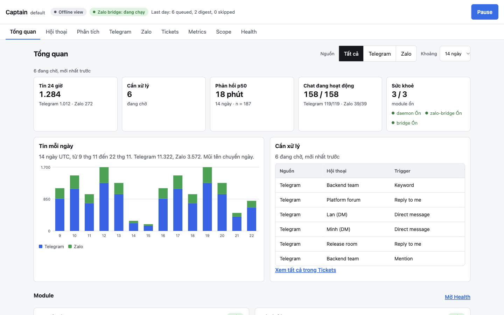
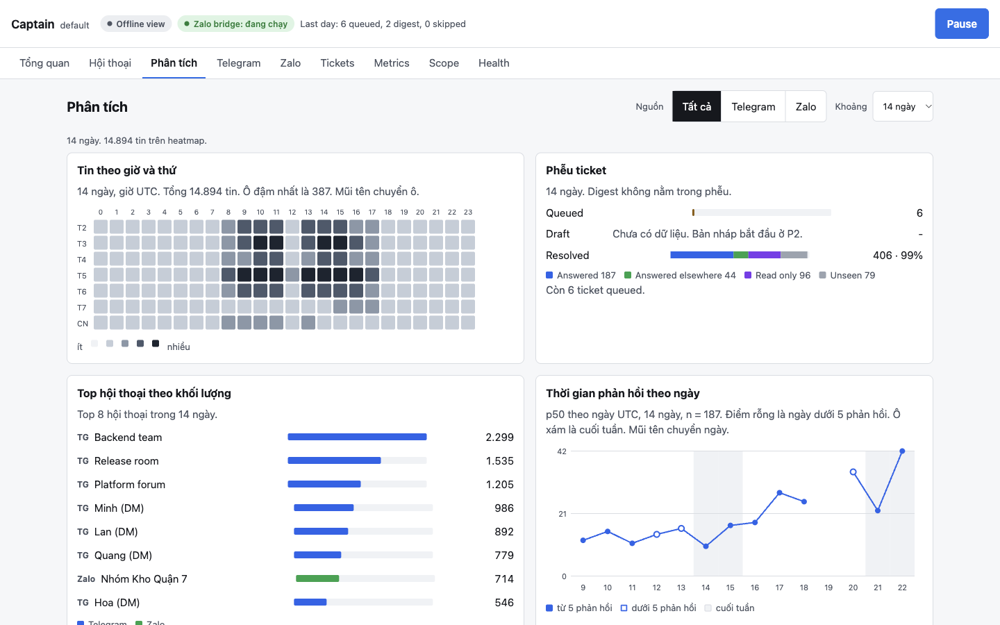
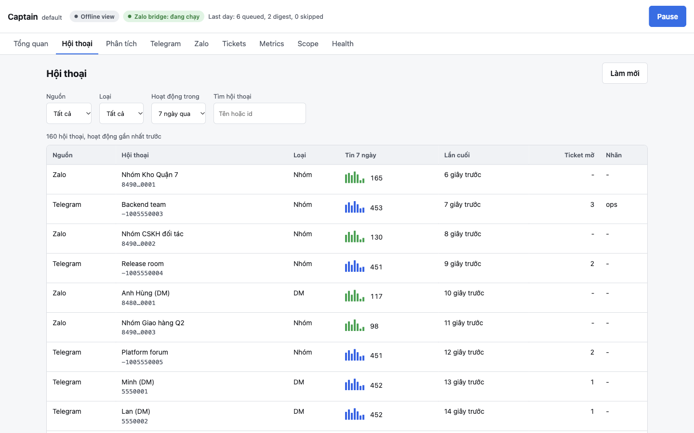
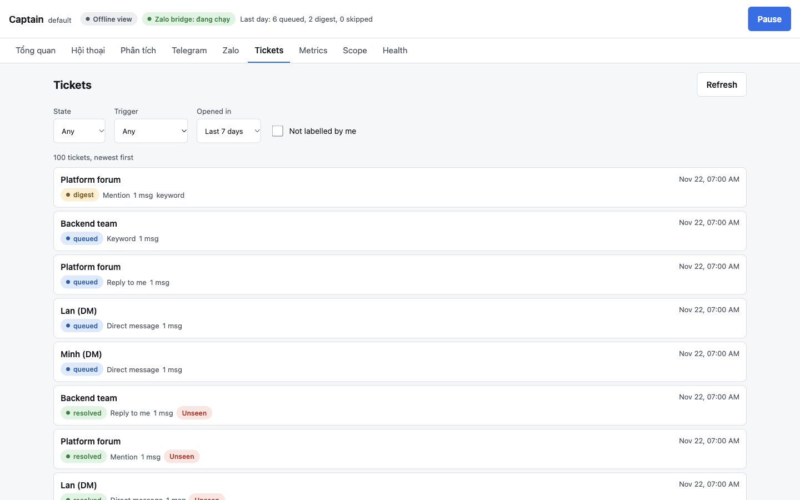
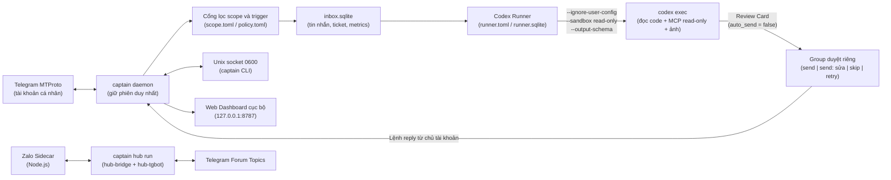

# Communicate Hub

[](https://github.com/nguyentantai21042004/communicate-hub/actions/workflows/ci.yml)
-orange)


Hệ thống daemon quản lý liên lạc cá nhân viết bằng Rust: chạy trực tiếp trên tài khoản Telegram cá nhân qua MTProto, kết hợp Codex Runner chạy cô lập ở chế độ chỉ đọc để tự điều tra và đẩy bản nháp về group duyệt riêng, cầu nối Zalo sang Telegram Forum, và giao diện web dashboard phân tích cục bộ.

Toàn bộ phiên Telegram được giữ bởi duy nhất một tiến trình (`captain daemon`) thông qua [grammers](https://codeberg.org/Lonami/grammers). Thông tin nhạy cảm nằm hoàn toàn trong macOS Keychain, phạm vi theo dõi áp dụng cơ chế từ chối mặc định (`scope.toml`), và mọi phản hồi gửi ra đều đi qua quy trình kiểm duyệt của chủ tài khoản.

## Giao diện sản phẩm

Dữ liệu hiển thị dưới đây được tạo từ lệnh giả lập `captain dev seed-demo`.

### Tổng quan và phân tích lưu lượng

| Tổng quan (KPI, lưu lượng ngày, danh sách cần xử lý) | Phân tích (Heatmap 7x24, phễu ticket, thời gian phản hồi) |
|---|---|
|  |  |

### Danh sách hội thoại hợp nhất và luồng ticket

| Hội thoại hợp nhất Telegram và Zalo | Hàng đợi và phân loại ticket |
|---|---|
|  |  |

## Kiến trúc hệ thống



## Tính năng chính

- **Telegram MTProto Daemon đơn phiên**: duy trì một kết nối tài khoản người dùng ổn định với cơ chế tự kết nối lại theo backoff, bộ nhớ đệm peer, phát hiện khoảng trống cập nhật (gap) và lưu trữ cục bộ tự dọn sau 30 ngày (`inbox.sqlite`).
- **Pipeline lọc và gom tin nhắn xác định**: chỉ theo dõi các chat khai báo trong `scope.toml`, hỗ trợ các trigger `dm_all`, `mention`, `reply_to_me`, `keyword`, tự gom chuỗi tin nhắn liên tiếp theo `debounce_secs` (`policy.toml`), hỗ trợ tạo ticket thủ công bằng cách forward vào `Saved Messages` kèm ghi chú `cap:`, và xuất báo cáo hiệu năng (`captain report --text`).
- **Codex Runner cô lập chỉ đọc**: chạy `codex exec` với `--ignore-user-config`, `--sandbox read-only`, `--ephemeral`, ép cấu trúc trả về bằng `--output-schema`, tự tải tối đa 3 ảnh chụp màn hình trong chuỗi tin (`-i`) và chỉ nối các MCP chỉ đọc được khai báo rõ trong `runner.toml`. Lịch sử chạy lưu riêng tại `runner.sqlite` để giữ tương thích hoàn toàn với schema v1 của `inbox.sqlite`.
- **Luồng duyệt qua group Telegram riêng**: đẩy thẻ review có cấu trúc (nguồn, link nhảy tới tin gốc, nội dung tin đến, tóm tắt kết quả kiểm tra, bản nháp trả lời) vào một supergroup riêng chỉ có một mình chủ tài khoản. Mặc định `auto_send = false`, chỉ gửi đi khi chủ tài khoản reply xác nhận.
- **Bộ lệnh tổ chức Telegram không gây thông báo cho đối phương**: đổi/đồng bộ tên danh bạ (`add_phone_privacy_exception = false`), xóa lịch sử DM một phía (`revoke = false`), tạo/sửa/xóa/sắp xếp Chat Folders, và tạo supergroup riêng tư.
- **Cầu nối Zalo và Dashboard hợp nhất**: ánh xạ hội thoại Zalo sang từng topic trong Telegram Forum (`captain hub`) và hiển thị toàn bộ chỉ số, hội thoại, ticket, scope trên giao diện web cục bộ khóa bằng token (`captain ui`).

## Cấu trúc workspace (15 crates)

| Crate | Tầng | Nhiệm vụ |
|---|---|---|
| `captain-core` | core | Các kiểu dữ liệu độc lập giao thức (tin nhắn, entity, danh bạ, folder, giới hạn Telegram). Không có I/O. |
| `captain-protocol` | protocol | Tầng MTProto bọc `grammers`: đăng nhập, lưu session trong Keychain, tải media, danh bạ, folder, dọn lịch sử DM. |
| `captain-format` | format | Chuyển cú pháp soạn thảo sang `FormattedText` (tính offset theo UTF-16). Không gọi mạng. |
| `captain-vault` | secrets | Lưu bí mật trong macOS Keychain (ẩn khi debug/display bằng `<redacted>`) và ghi file trạng thái `0600` nguyên tử. |
| `captain-inbox` | domain | Logic thuần cho inbox: khớp scope, luật trigger, gom burst, triage và tính toán báo cáo. |
| `captain-store` | storage | Quản lý `inbox.sqlite`: tin nhắn trong scope, ticket, sự kiện, metrics và thống kê gate drop. |
| `captain-ipc` | transport | Giao thức JSON-lines qua Unix socket `0600` giữa lệnh CLI và daemon đang chạy. |
| `hub-core` | bridge core | Các trait dùng chung cho adapter, sự kiện, hàng đợi gửi và kiểm tra sức khỏe bridge. |
| `hub-store` | bridge store | Bảng ánh xạ topic, ánh xạ tin nhắn, hàng đợi retry và log sức khỏe module. |
| `hub-zalo` | adapter | Giám sát và chuẩn hóa dữ liệu từ tiến trình sidecar Zalo viết bằng Node.js. |
| `hub-tgbot` | adapter | Client Telegram Bot API quản lý forum topic, album ảnh, reaction và giới hạn tốc độ. |
| `hub-bridge` | orchestration | Điều phối hai chiều giữa các adapter ngoài và Telegram Forum. |
| `hub-analytics` | analytics | Truy vấn chuỗi thời gian, heatmap, phễu chuyển đổi và bảng cảnh báo cho dashboard. |
| `hub-web` | web | Các route API Axum chỉ đọc và hàm che dữ liệu nhạy cảm cho giao diện web. |
| `apps/captain-cli` | app | File thực thi `captain`: CLI, daemon, Codex runner (`runner.rs`, `runner_store.rs`), Zalo bridge và web UI. |

Chi tiết kiến trúc và quy ước viết code xem thêm tại [docs/architecture.md](docs/architecture.md), [docs/CONVENTIONS.md](docs/CONVENTIONS.md) và thư mục [docs/design/](docs/design/).

## Hướng dẫn cài đặt nhanh

### 1. Build và đăng nhập

Cần có API ID và API Hash từ <https://my.telegram.org/apps>.

```sh
make build
cp target/release/captain ~/.local/bin/captain

captain auth init      # lưu API ID và API Hash vào macOS Keychain
captain auth login     # nhập SĐT, mã xác thực và mật khẩu 2FA (nếu có)
captain auth status
```

### 2. Cấu hình scope và policy

Thư mục lưu cấu hình theo profile nằm tại `~/Library/Application Support/telegram-captain/<profile>/`:

- `scope.toml`: danh sách DM, group, forum được phép theo dõi (xem [docs/design/scope.md](docs/design/scope.md)).
- `policy.toml`: thời gian gom burst (`debounce_secs`), ngưỡng tin cũ và số ngày lưu trữ.

```sh
captain chats --limit 100
captain scope check
captain daemon          # chạy trực tiếp trên terminal, Ctrl-C để dừng
```

Cài chạy nền tự động bằng macOS `launchd`:

```sh
make build && scripts/install-agent.sh
captain status
captain scope reload
```

### 3. Cấu hình Codex Runner và group duyệt riêng

Tạo một supergroup riêng chỉ có tài khoản của cậu, sau đó tạo `runner.toml` cùng thư mục `runner/` chứa `AGENTS.md` và `response.schema.json`:

```sh
captain group create --title "Captain Review" --about "Codex triage and draft review"
```

Ví dụ file `runner.toml` (daemon tự đọc lại sau mỗi chu kỳ poll, không cần khởi động lại):

```toml
enabled = true
review_chat_id = -1001234567890
engine = "codex"
codex_bin = "/Users/you/.local/bin/codex"
model = "gpt-6.1-terra"
reasoning_effort = "high"
timeout_secs = 180
poll_interval_secs = 5
max_daily_runs = 60
max_ticket_age_secs = 900
context_messages = 35
max_images = 3
post_declines = false

# Luôn giữ false cho tới khi xác minh chất lượng bản nháp thực tế.
auto_send = false
auto_send_allowed_chats = []

read_dirs = ["/path/to/codebases"]

[mcp_servers.mongo]
url = "http://127.0.0.1:27099/mcp"
```

### 4. Cách duyệt và gửi tin ngay trong group duyệt riêng

Reply trực tiếp vào bất kỳ thẻ Review Card nào do runner đăng lên:

| Nội dung reply | Hành động của daemon |
|---|---|
| `send`, `ok`, `go`, `gửi` | Gửi nguyên bản nháp về đúng chat và reply đúng tin gốc, đánh dấu `sent_as_is`. |
| `send: <nội dung sửa>`, `gửi: <nội dung sửa>` | Gửi đoạn văn bản cậu đã sửa về đúng chat gốc, đánh dấu `sent_edited`. |
| `skip`, `drop`, `no`, `bỏ` | Bỏ qua ticket và gắn nhãn `skip`. |
| `retry`, `rerun` | Đưa ticket vào hàng đợi để Codex kiểm tra lại từ đầu. |

Các lệnh CLI theo dõi và chạy thủ công:

```sh
captain tickets --days 1
captain ticket run <ticket_id>   # chạy Codex ngay cho một ticket cụ thể
captain runs --limit 20          # xem lịch sử và kết quả chạy của runner
captain report --text --days 14  # xem báo cáo chất lượng và gợi ý debounce
captain ui --open                # mở web dashboard cục bộ tại 127.0.0.1:8787
```

## Bộ lệnh tổ chức Telegram

Mọi thao tác đi qua daemon đang chạy qua Unix socket (hoặc tự giữ lock phiên nếu daemon đang tắt):

```sh
captain contacts
captain contact set --user <id_hoac_@user> --first-name "[TEAM] Tên" --last-name ""
captain chat-delete --chat <user_id>       # luôn đặt revoke=false (chỉ xóa phía mình)
captain folders
captain folder set --file folder.json
captain folder delete --id 2
captain folder order 0 2 3 4 5
```

## Ranh giới bảo mật và quyền riêng tư

- **Bí mật chỉ nằm trong Keychain**: API Hash và MTProto auth key chỉ lưu trong macOS Keychain (`dev.tantai.telegram-captain`). Các file trạng thái (`mtproto_state.json`, `inbox.sqlite`, `runner.sqlite`, `captain.sock`) luôn tạo với quyền `0600`.
- **Một tiến trình sở hữu một phiên**: file khóa `session.lock` ngăn chặn tuyệt đối việc hai tiến trình dùng chung một auth key.
- **Cô lập hoàn toàn runner AI**: `codex exec` chạy với `--ignore-user-config --sandbox read-only --ephemeral`, loại bỏ toàn bộ plugin người dùng và các MCP có quyền ghi. Toàn bộ nội dung tin nhắn và ảnh đính kèm được đánh dấu rõ là dữ liệu không đáng tin cậy.
- **Không gửi thông báo ngoài ý muốn**: `contact set` khóa cứng `add_phone_privacy_exception = false`; `chat-delete` chỉ chấp nhận hội thoại cá nhân và khóa cứng `revoke = false`.
- **Điều khoản Telegram API**: đọc kỹ [Telegram API Terms of Service](https://core.telegram.org/api/terms) (đặc biệt mục 1.5 về xử lý dữ liệu bằng AI) và [docs/design/risks.md](docs/design/risks.md) trước khi kích hoạt runner tự động.

## Phát triển và kiểm thử

```sh
make check      # fmt-check, clippy -D warnings, cargo test --workspace, lint-comments, target-gc
make web-test   # node --test cho các hàm thuần của dashboard
make build      # build bản release cho captain-cli
```

Lưu ý về dependency: `grammers` được ghim cố định ở `=0.10.0` và `glass_pumpkin` giữ ở `2.0.0-rc0` trong `Cargo.lock` (xem [docs/architecture.md](docs/architecture.md#dependency-pins)). Không chạy `cargo update` trần.
